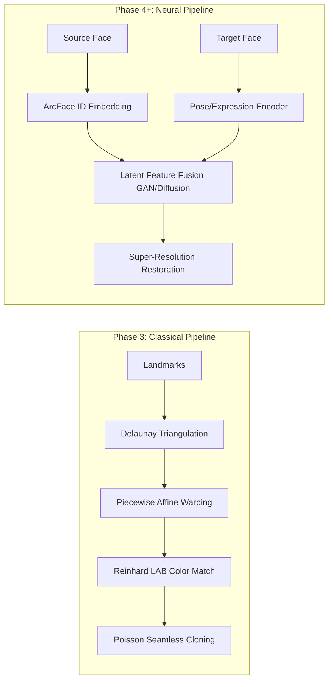

# Investigation: Pretrained Face-Swap Models, Licensing & Classical Limitations

This document provides a comparative analysis of modern deep learning face-swap models, licensing frameworks, and physical limitations inherent to facial replacement systems.

---

## 1. Deep Learning Face-Swap Models Evaluation

| Model Architecture | License | Underlying Backbone | Strengths | Limitations | Suitability for FYP |
|:---|:---|:---|:---|:---|:---|
| **InsightFace (InSwapper-128 / buffalo_l)** | **Non-Commercial Research License** | ArcFace (ResNet) + InSwapper GAN | • Single-shot (no training needed) • Preserves identity traits sharply • Fast inference (30-60 ms on GPU) | • 128x128 resolution requires Real-ESRGAN upscaler • Strictly non-commercial | **Recommended for prototype demo & Colab** |
| **SimSwap (Zhejiang University)** | **CC-BY-NC 4.0 (Non-Commercial)** | Modified ResNet + ID Injection Blocks | • Strong pose and expression retention • High-resolution variants (512x512) | • Sensitive to extreme head yaw (>60°) • Large model footprint (~400MB) | Strong candidate for Phase 4/6 |
| **DeepFaceLab (DFL)** | **GPL-3.0** | SAEHD Encoder-Decoder (DeepFake) | • Industry standard realism • Full resolution texture preservation | • Requires hundreds/thousands of images per subject • Needs hours/days of GPU training | Unsuitable for real-time / single-shot app |
| **Ghost (SberAI)** | **Apache-2.0** | Eye-loss guided GAN | • Permissive open-source license • Good eye gaze alignment | • Struggles with partial facial occlusions | Viable alternative if commercial license needed |

> [!IMPORTANT]
> **Licensing Recommendation**: For academic demonstration, **InsightFace (InSwapper)** and **SimSwap** provide the best trade-off between visual realism, single-shot speed, and ethical research alignment. Because both models utilize **Non-Commercial Research licenses**, any future production deployment must use Apache-2.0 alternatives (such as Ghost) or custom fine-tuned diffusion models (as targeted in Phase 4).

---

## 2. Classical Geometric Swapping vs. Neural Swapping

---

## 3. Classical Face Swapping Limitations

### 1. Extreme Head Rotation & Out-of-Plane Yaw
- **Symptom**: When source and target faces have mismatched orientations (e.g., source is frontal $0^\circ$, target is profile $45^\circ$), piecewise affine warping shears the texture unevenly.
- **Root Cause**: 2D Delaunay triangles cannot synthesize missing occluded cheek or ear geometry without a full 3D morphable model (3DMM) or generative inpainting.

### 2. Disparate Ambient Lighting and Cast Shadows
- **Symptom**: Hard cast shadows (e.g. sunlight under the nose or brow) from the source face appear unnatural when pasted into a target with diffuse indoor lighting.
- **Root Cause**: While Poisson blending (`cv2.seamlessClone`) solves the gradient boundary condition, it does not re-light internal specular highlights. Reinhard CIELAB matching helps globally, but local directional light discrepancies persist.

### 3. Facial Occlusions (Hands, Glasses, Hair Strands)
- **Symptom**: If the target face has fingers, hair fringes, or eyeglasses across the cheek, classical Delaunay warping warps the source skin over the obstacle, obliterating foreground layers.
- **Mitigation for Phase 5/8**: BiSeNet / MediaPipe selfie segmentation masks to segment foreground occluders and restore them over the blended swap.

### 4. Expression Disparity (Mouth Open vs. Closed)
- **Symptom**: Swapping an open laughing mouth onto a neutral closed mouth causes inner teeth and tongue triangles to warp into lip margins.
- **Mitigation**: Topological triangulation constraint masking or expression normalization.
